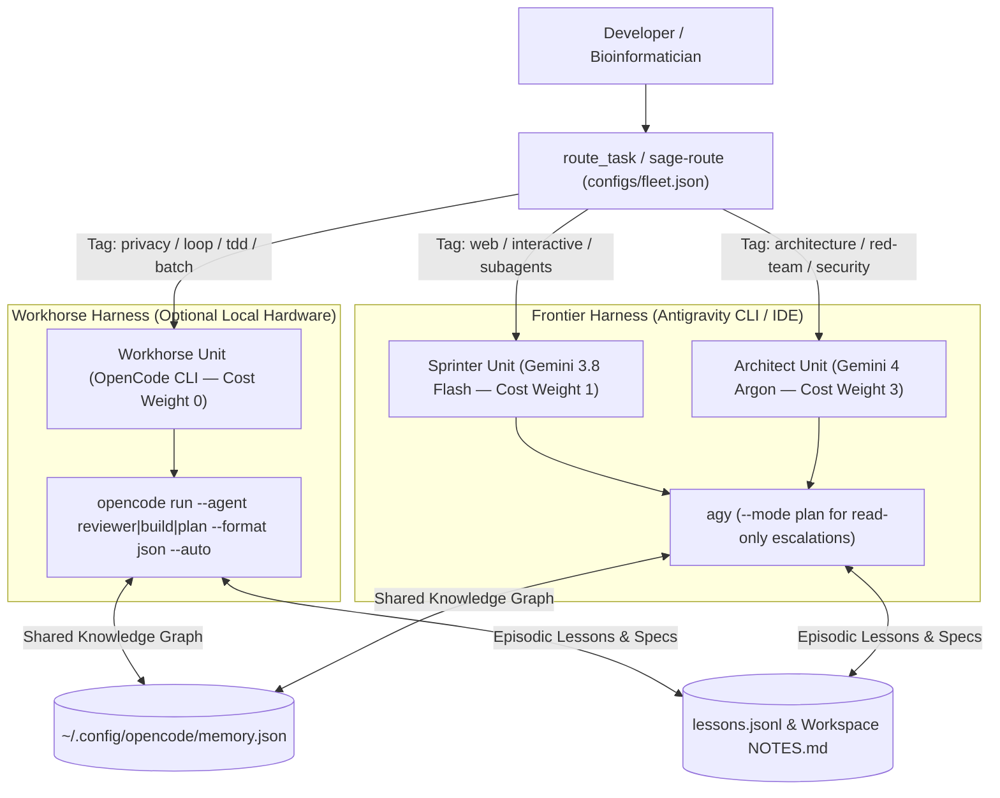

# System Architecture: Hybrid SAGE (Elastic OpenCode + Antigravity Symbiosis)

## Overview

`hybrid-sage` is a cross-harness orchestration and privacy-airgap plugin connecting **OpenCode** (serving any configured local or OpenAI-compatible provider, such as `llama-server`, Ollama, LM Studio, or vLLM) with **Antigravity** (`agy`, serving upstream frontier models such as Gemini 3.8 Flash and Gemini 4 Argon). If no local OpenCode worker is running, cloud sessions degrade gracefully to cloud-only execution.

All active units are declared in [`configs/fleet.json`](../configs/fleet.json). You can scale your fleet down to **1–2 units** (cloud-only or 1 local + 1 cloud) or up to **N units** with zero code changes.

## Adapting `configs/fleet.json` to Your Topology

### Scenario A: Cloud-Only (No Local Model Hardware)
If you run Antigravity without a local inference server:
- `fleet_status` reports `opencode_runtime.online: false`, and `delegate_local(skip_if_busy=True)` returns cleanly without blocking so all tasks execute directly on `cloud-sprinter` / `frontier-architect`.

### Scenario B: 2-Unit Topology (1 OpenCode Workhorse + 1 Upstream Cloud)
1. Set `"enabled": false` on `cloud-sprinter` (or `frontier-architect`) in `configs/fleet.json`, and add `"web"`, `"interactive"` tags to your single active cloud unit.
2. `route_task` routes private/loop work to `local-workhorse` and web/architecture/escalation work to your upstream unit.

### Scenario C: 3-Unit Default Symbiosis (`local-workhorse` + `cloud-sprinter` + `frontier-architect`)
- `local-workhorse` (`OpenCode`) handles routine coding, TDD loops, boilerplate, and cross-family diff reviews (`mode="review"`).
- `cloud-sprinter` (`Gemini 3.8 Flash`) handles interactive multi-file implementation, web search, and parallel subagents.
- `frontier-architect` (`Gemini 4 Argon`) handles greenfield architecture, `/red-team`, security audits, and 2-strike `escalate_task` diagnoses.
