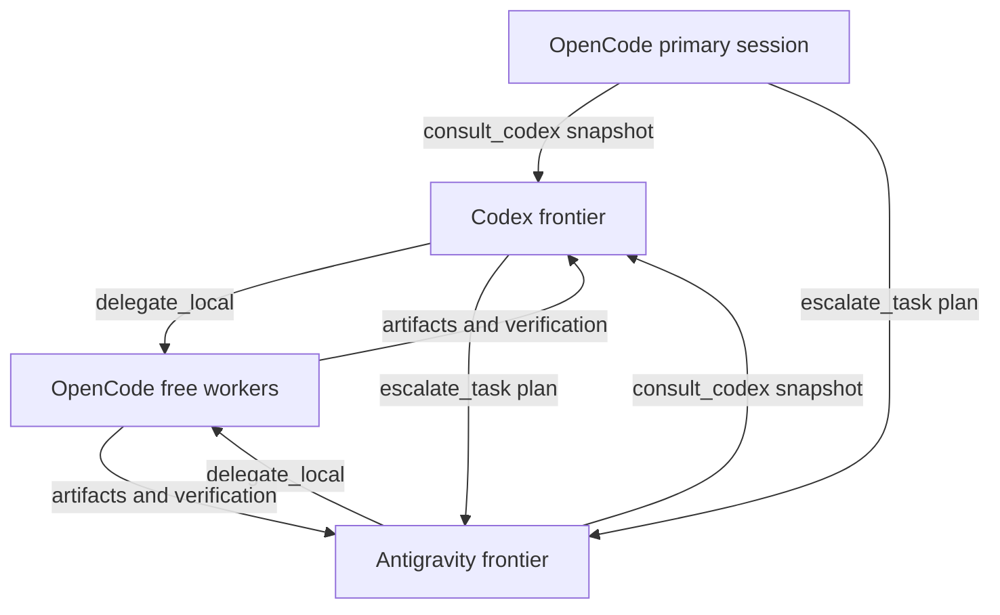

# Three-harness architecture

Hybrid SAGE exposes eight stdio MCP tools to Codex, Antigravity, and OpenCode.
Frontier sessions perform planning and final review; OpenCode workers execute
bounded implementation and test loops with an operator-approved free model.

`plugins/mcp_core.py` owns dispatch, provider discovery, policy, scanning, and
handoffs. `plugins/mcp_server.py` exposes JSON-RPC and reloads core changes.
`configs/fleet.json` declares routing units and free worker policy; optional
`fleet.local.json` overrides machine-specific choices.

Async jobs run through `scripts/worker-runner.py`. A shared file lock caps active
jobs, a supervisor records the actual exit status and optional verification, and
polling reads persistent results even after the MCP server restarts. Workers own
disjoint paths or worktrees. Failed jobs cannot silently fall back to paid models.
`HYBRID_SAGE_CHILD` blocks recursive delegation across all child harnesses.

The OpenCode plugin uses v2 domain transforms for MCP, skills, commands, and
context hooks. A v1 server adapter remains available. The installer registers the
repository package directory rather than a single `.mjs` file.

Codex consultation uses scanned snapshots and disables project tools. OpenCode
and Antigravity plan sessions may inspect their project with tools; regex scanning
is defense in depth rather than a complete data-isolation boundary. Notes and
lessons are project-scoped evidence to verify, not authoritative instructions.
